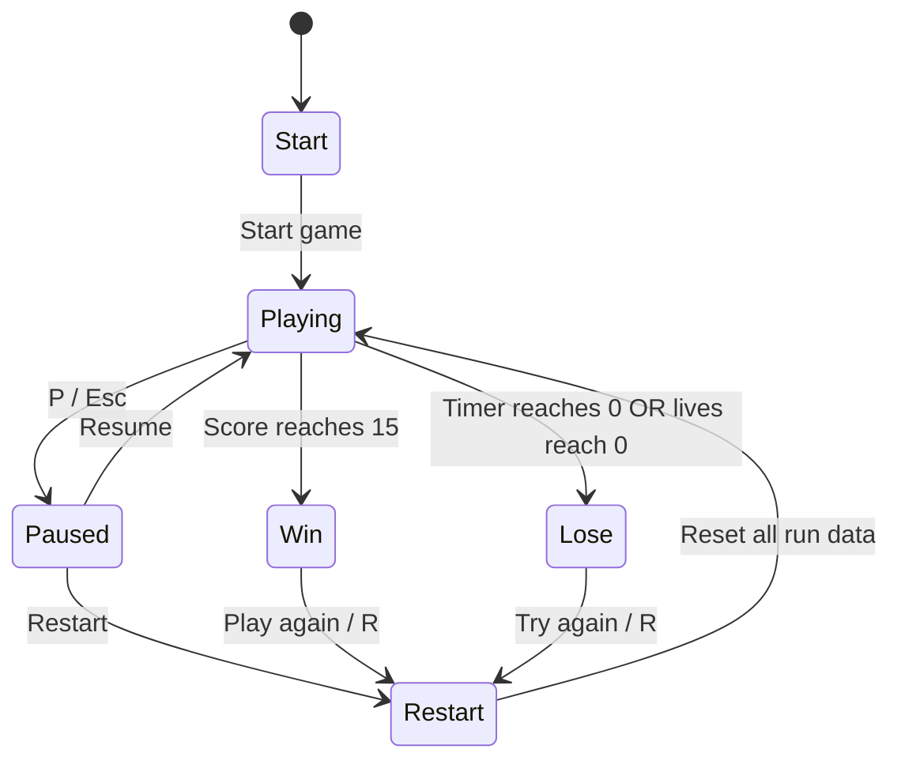

# State Diagram — Coin Quest 2

- **Start:** instructions show; simulation is stopped.
- **Playing:** timer, movement, collisions, score, hazards update.
- **Paused:** simulation and timer freeze.
- **Win:** collect 15 coins; game loop stops.
- **Lose:** timer expires or all three lives are lost.
- **Restart:** resets score, level, timer, lives, coins, hazards and particles before entering Playing.
